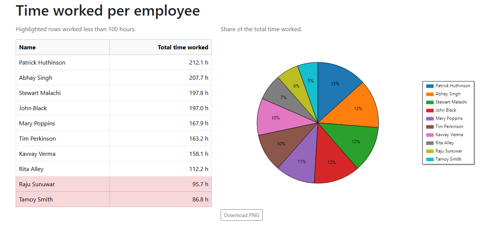
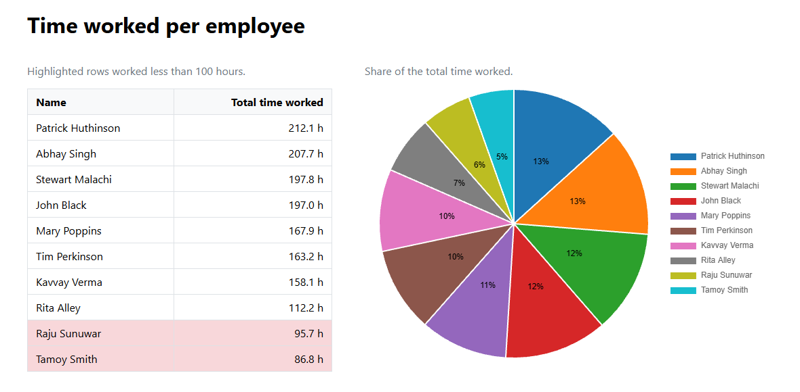
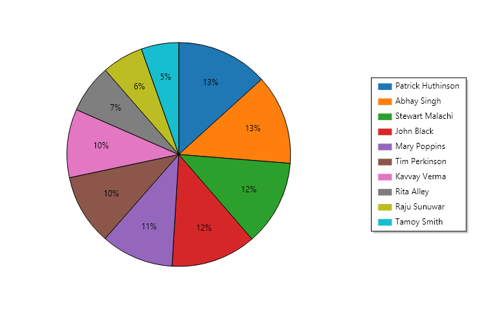

# Time Entries

Two small apps built for the Rare Crew technical assignment. Both read time entries from the provided API,
group them by employee, sum the hours worked and show the result as a table and a pie chart.

| App | Folder | Table | Pie chart |
| --- | --- | --- | --- |
| ASP.NET Core MVC (.NET 10) | [`csharp/`](csharp) | Razor view | PNG generated on the server with ScottPlot |
| Angular 22 | [`angular/`](angular) | Component | Chart.js in the browser |

Employees are ordered by total time worked, descending. Rows with less than 100 hours are highlighted.

## Screenshots

**ASP.NET Core MVC**



**Angular**



The pie chart PNG produced by the C# app (also available through the **Download PNG** button):



## Prerequisites

- [.NET 10 SDK](https://dotnet.microsoft.com/download)
- [Node.js 22](https://nodejs.org/) with npm
- The API key from the assignment

The key is not stored anywhere in this repository. Each app reads it from a place outside the repo,
as described below.

## Running the C# app

The key is stored with [User Secrets](https://learn.microsoft.com/aspnet/core/security/app-secrets),
which keeps it in your user profile instead of the project folder.

```powershell
cd csharp/TimeEntries.Web
dotnet user-secrets set "TimeEntryApi:Key" "<your-key>"
dotnet run
```

Open http://localhost:5128.

User Secrets are only loaded in the `Development` environment, which `dotnet run` uses by default
through `Properties/launchSettings.json`.

### Tests

From the repository root:

```powershell
dotnet test csharp/TimeEntries.slnx
```

## Running the Angular app

The Angular dev server forwards `/api` requests to the time entries API and adds the key on the way
(see [`angular/proxy.conf.js`](angular/proxy.conf.js)). The key is read from an environment variable,
so it never ends up in the code that is sent to the browser.

```powershell
cd angular
npm install
$env:TIME_ENTRY_API_KEY = "<your-key>"
npm start
```

Open http://localhost:4200.

The environment variable only lives in the current terminal, so set it again in every new terminal
before running `npm start`. On macOS or Linux use `export TIME_ENTRY_API_KEY="<your-key>"`.

### Tests

From the `angular` folder:

```powershell
npx ng test --watch=false
```

## How it is built

### C# (`csharp/TimeEntries.Web`)

| File | Responsibility |
| --- | --- |
| `Services/TimeEntryApiClient.cs` | Calls the API through a typed `HttpClient` and adds the key from configuration. |
| `Services/EmployeeHoursCalculator.cs` | Filters, groups and sums the entries. Pure logic with no I/O, covered by unit tests. |
| `Services/HoursPieChart.cs` | Draws the pie chart with ScottPlot and returns it as PNG bytes. |
| `Controllers/HomeController.cs` | `Index` renders the table, `Chart` returns the PNG (`?download=true` returns it as a file download). |

The page shows the chart with a plain ``, so no JavaScript is involved in drawing it.

### Angular (`angular/src/app`)

| File | Responsibility |
| --- | --- |
| `app.ts` | Loads the entries with `httpResource` and calculates the totals. |
| `employee-hours.ts` | The same filtering and summing rules as the C# calculator, covered by unit tests. |
| `employee-table/` | Displays the table. |
| `employee-chart/` | Displays the pie chart with Chart.js and `chartjs-plugin-datalabels` for the percentages. |

`App` owns the data. The table and chart components only display what they receive through `input()`.
Both apps use the same color palette (Category10), so the charts look the same.

## Data handling

The API returns raw entries, some of which can't be counted as time worked. Both apps apply the same rules:

- **Deleted entries** (`DeletedOn` is set) are skipped.
- **Entries without an employee name** are skipped.
- **Entries without a positive duration** (the end time is before or equal to the start time) are skipped.
- **Names are trimmed** before grouping, so `"John Black "` and `"John Black"` are the same employee.
  Grouping is case-sensitive.
- **Times are UTC.** The API sends them without a time zone suffix, so the Angular app parses them
  explicitly as UTC. Otherwise durations around daylight saving changes would be off by an hour.
- The API names the start time field `StarTimeUtc`. The C# model maps it to a property called `StartTimeUtc`.

Hours are shown with one decimal place. Chart percentages are rounded to whole numbers, so they don't
always add up to exactly 100%.

## Possible improvements

- **Caching in the C# app.** A page load calls the API twice: once for the table and once for the chart
  image. Caching the entries for a short time with `IMemoryCache` would avoid the second call.
- **A backend for the Angular app in production.** The proxy only exists while `ng serve` is running.
  In production, a backend endpoint (for example in the C# app) would add the key, or would return
  the already calculated totals, and the key would come from an environment variable or Azure Key Vault.
- **Friendlier error state in the C# app.** If the API is unavailable, the C# app falls back to the
  generic error page. The Angular app shows an inline message instead.
